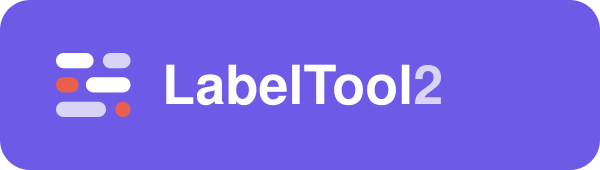
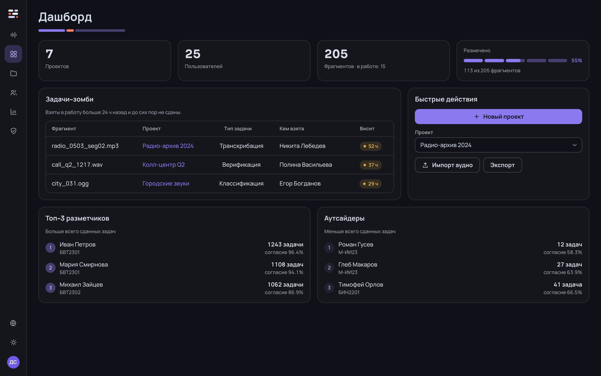
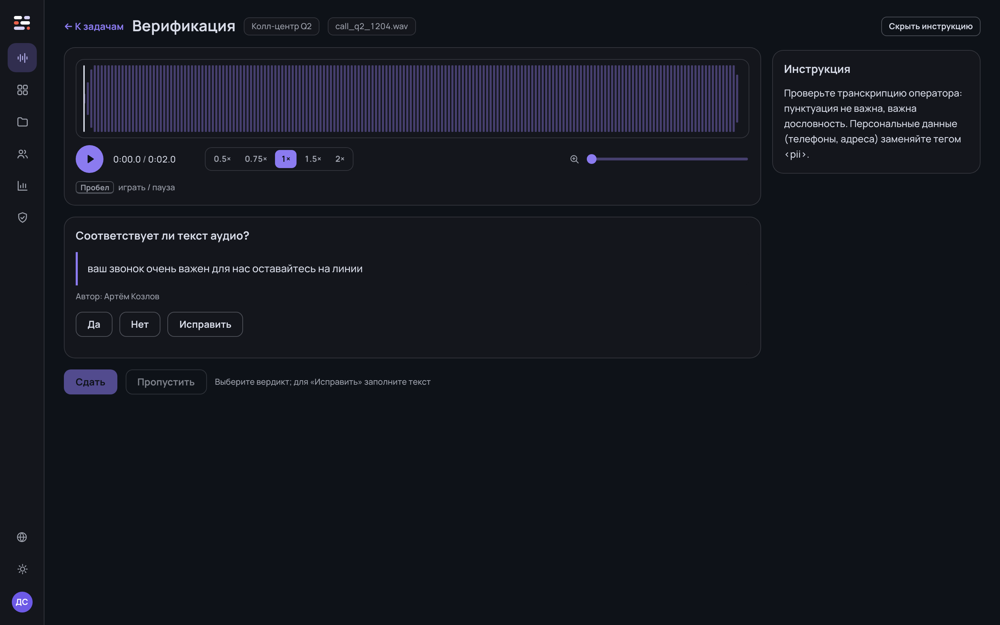
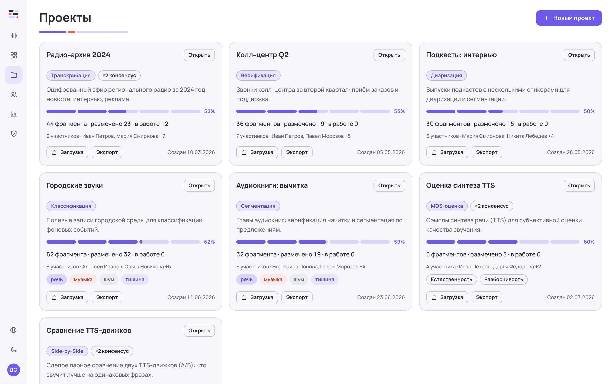

<p align="center">
  
</p>

<p align="center">
  <b>English</b> &nbsp;·&nbsp; <a href="README.ru.md">Русский</a>
</p>

<p align="center">
  A multi-user audio annotation platform — from upload to a ready-to-use dataset.
</p>

<p align="center">
  
  
  
  
  
  
</p>

<p align="center">
  
  
</p>

---

## What is it

**LabelTool 2** is a web app for team audio annotation. Admins create projects and
upload data, annotators complete tasks, and the system gathers consensus, computes
statistics, and exports a ready-to-use dataset.

## Features

- 🎧 **7 task types** — transcription, verification, classification, segmentation,
  diarization, **MOS rating** (configurable 1–5 scales) and **Side-by-Side** (blind
  pairwise TTS comparison with randomized order).
- 🤝 **Consensus** — K annotators per fragment, reference by majority vote.
- 📥 **Upload** — batch drag-and-drop (MP3/WAV/FLAC/OGG up to 200 MB), CSV/JSONL manifest,
  and **connect an S3/MinIO bucket by reference** (no byte copying).
- 📤 **Export** — JSONL, CSV, NeMo manifest, Praat TextGrid, CoNLL, SRT/VTT.
- 🌊 **Waveform player** — regions, 0.5–2× speed, zoom, hotkeys.
- 👥 **Users & permissions** — per-task-type permission matrix, roles, groups, self sign-up.
- 📊 **Statistics** — annotator agreement, project progress, zombie tasks.
- 🌗 Light/dark themes · 🌐 RU/EN · ♿ WCAG AA accessibility.

<p align="center">
  
</p>

## Quick start (Docker)

```bash
git clone git@github.com:lab260ru/LabelTool-2.git && cd LabelTool-2
cp .env.example .env           # set passwords, SECRET_KEY and the super-admin account
docker compose up -d --build   # app → http://localhost:8080
```

The database starts **empty** — only the super-admin from `.env` (`SUPERUSER_*`). Other
users are created by an admin or sign up themselves (`/register`). To preload sample
data set `SEED_DEMO=true`.

## Development

Start the backend, then the frontend dev server (it proxies `/api` → `:8000`):

```bash
# 1. Backend
cd backend
python3.12 -m venv .venv && .venv/bin/pip install -r requirements.txt
.venv/bin/alembic upgrade head          # migrations
.venv/bin/python -m src.seed            # super-admin from env (SUPERUSER_*)
.venv/bin/uvicorn src.main:app --port 8000

# 2. Frontend (in another terminal)
npm install
npm run dev                             # http://localhost:5173
```

## Tests

```bash
cd backend && .venv/bin/pytest         # 298 backend tests
npx tsc -b && npm run build            # types + production frontend build
node scripts/i18n-check.mjs            # ru/en dictionary completeness
```

## Stack

**Frontend** — React + TypeScript + Vite, react-i18next.
**Backend** — FastAPI + SQLAlchemy 2 + Alembic, PostgreSQL, S3/MinIO.
**Production** — Docker Compose: nginx (SPA + proxy) · FastAPI · PostgreSQL 16 · MinIO.

---

<p align="center"><sub>© 2026 lab260ru · LabelTool 2</sub></p>
