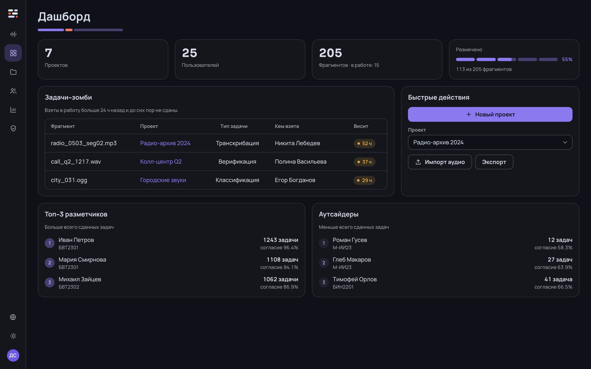
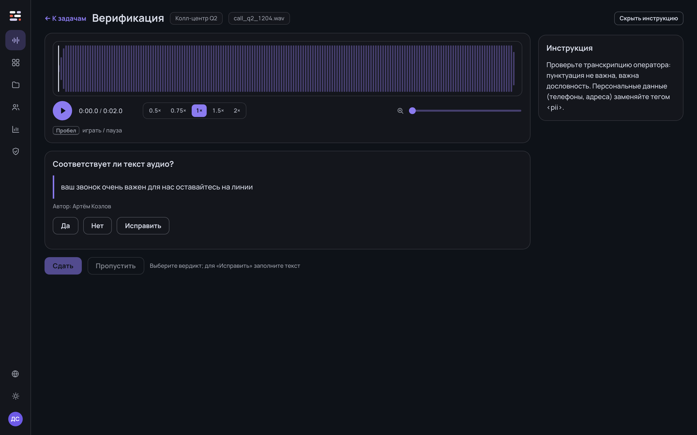
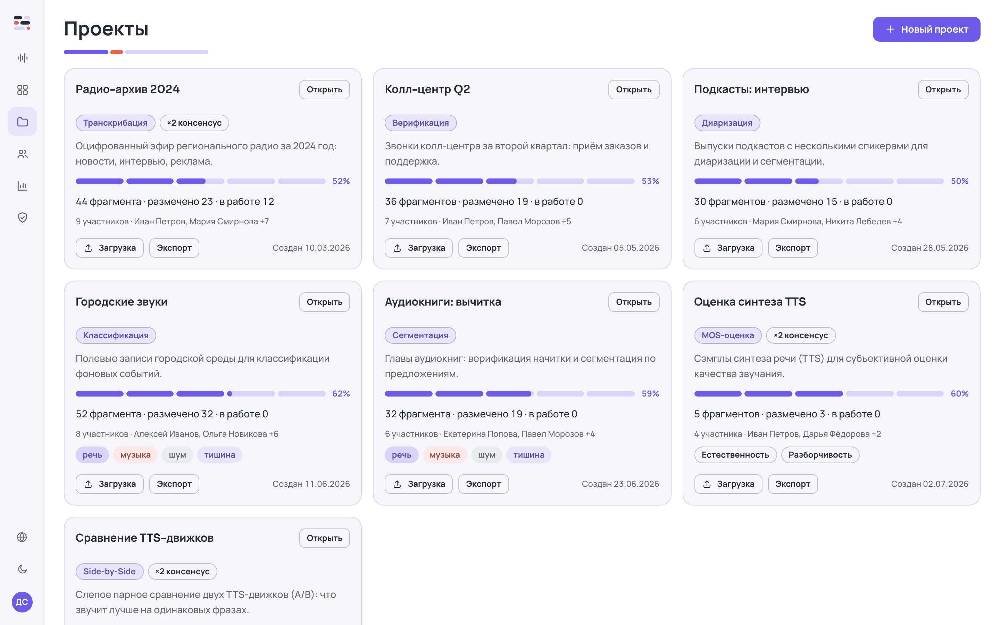

<p align="center">
  
</p>

<p align="center">
  <a href="README.md">English</a> &nbsp;·&nbsp; <b>Русский</b>
</p>

<p align="center">
  Веб-платформа многопользовательской разметки аудио — от загрузки до готового датасета.
</p>

<p align="center">
  
  
  
  
  
  
</p>

<p align="center">
  
  
</p>

---

## Что это

**LabelTool 2** — веб-приложение для командной разметки аудио. Администратор
заводит проекты и загружает данные, разметчики выполняют задачи, система собирает
консенсус, считает статистику и экспортирует готовый датасет.

## Возможности

- 🎧 **7 типов задач** — транскрибация, верификация, классификация, сегментация,
  диаризация, **MOS-оценка** (настраиваемые шкалы 1–5) и **Side-by-Side** (слепое
  парное сравнение TTS со случайным порядком).
- 🤝 **Консенсус** — K разметчиков на фрагмент, эталон по большинству голосов.
- 📥 **Загрузка** — batch drag-and-drop (MP3/WAV/FLAC/OGG до 200 МБ), CSV/JSONL-манифест
  и **подключение бакета S3/MinIO по ссылке** (без копирования байтов).
- 📤 **Экспорт** — JSONL, CSV, NeMo manifest, Praat TextGrid, CoNLL, SRT/VTT.
- 🌊 **Плеер с волновой формой** — регионы, скорость 0.5–2×, зум, хоткеи.
- 👥 **Пользователи и права** — матрица прав по типам задач, роли, группы, саморегистрация.
- 📊 **Статистика** — согласие разметчиков, прогресс проектов, задачи-зомби.
- 🌗 Светлая/тёмная темы · 🌐 RU/EN · ♿ доступность WCAG AA.

<p align="center">
  
</p>

## Быстрый старт (Docker)

```bash
git clone git@github.com:lab260ru/LabelTool-2.git && cd LabelTool-2
cp .env.example .env           # укажите пароли, SECRET_KEY и учётку супер-админа
docker compose up -d --build   # приложение → http://localhost:8080
```

БД поднимается **пустой** — только супер-админ из `.env` (`SUPERUSER_*`). Остальных
пользователей заводит админ или они регистрируются сами (`/register`). Для
демо-наполнения примерами задайте `SEED_DEMO=true`.

## Разработка

Запустите бэкенд, затем dev-сервер фронта (он проксирует `/api` → `:8000`):

```bash
# 1. Бэкенд
cd backend
python3.12 -m venv .venv && .venv/bin/pip install -r requirements.txt
.venv/bin/alembic upgrade head          # миграции
.venv/bin/python -m src.seed            # супер-админ из env (SUPERUSER_*)
.venv/bin/uvicorn src.main:app --port 8000

# 2. Фронтенд (в другом терминале)
npm install
npm run dev                             # http://localhost:5173
```

## Тесты

```bash
cd backend && .venv/bin/pytest         # 298 тестов бэкенда
npx tsc -b && npm run build            # типы + прод-сборка фронта
node scripts/i18n-check.mjs            # полнота словарей ru/en
```

## Стек

**Фронтенд** — React + TypeScript + Vite, react-i18next.
**Бэкенд** — FastAPI + SQLAlchemy 2 + Alembic, PostgreSQL, S3/MinIO.
**Прод** — Docker Compose: nginx (SPA + proxy) · FastAPI · PostgreSQL 16 · MinIO.

---

<p align="center"><sub>© 2026 lab260ru · LabelTool 2</sub></p>
